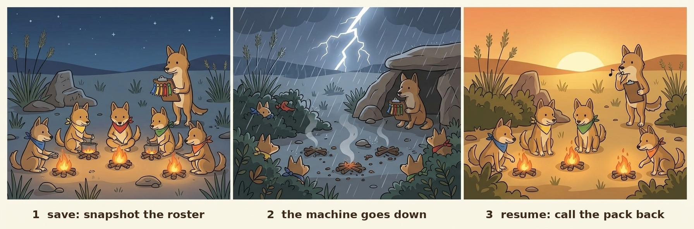

# 🐕 dingo-pack

<p align="center">
  
</p>

**Ein Rudel Coding-Agenten auf einem Rechner: Schwere Arbeit bekommt einen Slot, wird nach Speicher zugelassen und läuft unter Aufsicht; dingo weiß, wer läuft und – nach einem Absturz – wer verloren ging.**

```sh
dingo-pack run --heavy --mem 4G -- pytest   # waits for a slot and free memory, runs under a cap
dingo-pack watch --daemon                   # watches every process: alert, pause, resume, kill at the edge
dingo-pack who                              # who runs what, room left, paused jobs, stalled sessions
dingo-pack list                             # after a crash: which sessions were lost
dingo-pack resume --midway --via print      # the command that continues each of them
```

🌐 [English](https://github.com/liyifreddy/dingo-pack/blob/main/README.md) · **Deutsch** · [中文](https://github.com/liyifreddy/dingo-pack/blob/main/README.zh-CN.md)

Das Rudel frisst der Reihe nach: Dingos teilen sich eine Beute ohne Gerangel. dingo-pack ist der
Rudelführer für ein Dutzend Coding-Agenten auf einer Maschine. Seine fünf Kernaufgaben:

1. **Slots für schwere Arbeit** – Tests, Builds, Training und Exporte warten, bis sie dran sind (`run --heavy`).
2. **Zulassung nach Speicher** – ein Job kommt hinein, wenn sein angegebener Spitzenwert in das passt, was frei ist
   (abzüglich dessen, was laufenden Jobs zugesagt wurde, und einer Reserve); CPU-Slots = Kerne; nichts ist eine feste Zahl.
3. **Aufsicht während des Laufs** – `watch` sieht jeden Prozess des Benutzers, auch solche, die nicht
   über dingo gestartet wurden: Es schlägt Alarm, pausiert (SIGSTOP) den Job, der die Maschine
   herunterreißen würde, setzt ihn fort, wenn wieder Platz ist, und beendet erst am Rand; es meldet auch eine Session, deren
   Statuszeile `running` sagt und sich seit 2 h nicht bewegt hat.
4. **Wer läuft** – `who` / das Roster: Sessions, ihre Jobs, Speicher, Statuszeilen.
5. **Wer nach einem Absturz verloren ging** – das Roster wird während der Arbeit gesichert (`save` / `mark`); `list`
   zeigt, wer verloren ging, und `resume --via print` gibt den Befehl aus, der jede Session fortsetzt.
   Zwei Sicherheitsnetze: dingo führt das Roster jeder Session auf der Maschine, shepherd-dispatch
   führt die, die es selbst gestartet hat.

Im Umzug (funktioniert hier weiter, jeweils mit Hinweis, wohin es zieht): `board`, `name`, `card`, `lint`,
`queue` → shepherd-dispatch; `claim`, `boxes` → boobook-watch. Nicht mehr gepflegt (funktioniert
aber noch): `close-all`, `stow` und das Öffnen von Terminal-Tabs (`resume` / `restore` / `unstow` mit
`--via wt|tmux`); `--via print` bleibt.

## 🚀 Schnellstart

```sh
pipx install git+https://github.com/liyifreddy/dingo-pack

dingo-pack                                    # one screen: memory, slots, sessions
dingo-pack run --heavy --mem 4G -- pytest     # heavy work waits for a slot and free memory
dingo-pack doctor                             # what's wrong with this machine right now?
dingo-pack stuck                              # who is stuck in the kernel, and what piles up behind it
dingo-pack watch guard --once --every 60      # cron, every minute: restart the watch if it is gone or its scan is stale
dingo-pack list                               # after a crash: which sessions were lost
dingo-pack resume --midway                    # reopen the ones that were mid-task
```

In Claude Code installierst du das Plugin, und das Roster sichert sich selbst:

```
/plugin marketplace add liyifreddy/dingo-pack
/plugin install dingo-pack@dingo-pack
```

Eine Datei, Python ≥ 3.8, nur die Standardbibliothek. Linux, macOS und WSL.

## Release und Installations-Demo

Aktuelles Release: **0.5.4**. Installiere es von PyPI mit pip oder pipx:

```sh
python3 -m pip install dingo-pack        # or: pipx install dingo-pack
dingo-pack --version
```

Zur Installation aus diesem Quellbaum nutze stattdessen eine separate Umgebung:

```sh
python3 -m venv .venv-demo && .venv-demo/bin/python -m pip install .
.venv-demo/bin/dingo-pack --version
.venv-demo/bin/dingo-pack run --heavy --threads 1 --mem 64M -- python3 -c 'print("hello")'
```

Erwartet wird bei beiden: `dingo-pack 0.5.4`; die Quell-Demo gibt zusätzlich `hello` aus
(die Zulassung kann warten). Zustand und Locks müssen auf einer lokalen Platte liegen; lass `DINGO_HOME`
auf dem Standardwert, außerhalb eines in WSL eingebundenen Laufwerks. `boxes`, `tokens`, die Adapter-Validierung
und die Task-/Wait-Spalten sind enthalten; `dispatch` und der vollständige Drei-Tabellen-Abgleich
sind es nicht (dispatch ist Aufgabe von shepherd-dispatch). Siehe [CHANGELOG](CHANGELOG.md) und
[Release-Verfahren](RELEASING.md).

## Plattformen und Agenten

| Plattform | Unterstützungsgrenze | Für diesen Kandidaten getestet |
|---|---|---|
| Linux | POSIX-CLI und `/proc`-Überwachung | WSL-Linux-Kernel getestet; separater nativer Linux-Host nicht getestet |
| WSL2 | Python und die CLI innerhalb von WSL ausführen; Zustand auf der Linux-Platte | Getestet: komplette Suite, begrenztes CSV und Installations-Smoke-Test |
| macOS | POSIX-CLI, Fallbacks über `ps`/`vm_stat`; Linux-spezifische Probes können unbekannt sein | Nicht getestet; portabler CI-Job hinzugefügt, noch nicht gelaufen |
| Natives Windows | Nicht unterstützt: benötigt `fcntl`, POSIX-Signale und Ressourcenlimits; nutze WSL2 | Mit nativem Windows-Python 3.14 getestet: verwertbare Meldung „nicht unterstützte Plattform“, Exit 2 |

Alle drei Agenten können auf einem unterstützten Host dieselbe `run`-Queue nutzen. Für das Einpacken eines
Shell-Befehls ist kein toolspezifischer Hook nötig. Die Konfigurationsbeispiele unten sind manuelle
Anweisungen, keine erzwingenden Hooks.

- **Claude Code:** Die oben beschriebene Plugin-Installation liefert die Hooks; siehe [REFERENCE](REFERENCE.md)
  für die manuelle Hook-Konfiguration. Der mitgelieferte `skills/dingo-pack/SKILL.md` liefert Anleitung.
- **Codex:** Füge die folgende Regel in die `AGENTS.md` des Projekts ein. Optional kopiere
  `skills/dingo-pack/SKILL.md` in diesem Projekt nach `.agents/skills/dingo-pack/SKILL.md`.
- **OpenCode Go:** Wenn du OpenCode mit Go nutzt, schreibe dieselbe Regel in die `AGENTS.md` des Projekts.
  Alternativ verweise in `opencode.json` auf eine Regeldatei:
  `{"$schema":"https://opencode.ai/config.json","instructions":["docs/heavy-work.md"]}`.
  dingo-pack braucht keine Anbieter-Zugangsdaten.

```markdown
Before heavy shell work, run `dingo-pack who`, then wrap the command:
`dingo-pack run --heavy --mem <estimated peak> -- <command>`.
Use the same local DINGO_HOME for all agents sharing the machine.
Keep the queue and memory limits in force; report failures with the diagnostic line.
```

Claude Code hat einen eingebauten Session-/Token-Adapter. Codex und OpenCode können dieselbe
Queue nutzen, aber automatische Session-Erkennung, Token-Zählung, Resume und Close gibt es für sie
nicht. Externe, nur lesende Adapter können `top`/`tokens`/Task-Spalten erweitern;
[ADAPTERS](ADAPTERS.md) definiert diese Schnittstelle. Roster und Ghosts sind weiterhin Claude-spezifisch.
Für die Tests dieses Kandidaten wurden keine Agent-UI-Sessions gestartet.

Quellen: [Codex-Anweisungen](https://learn.chatgpt.com/docs/agent-configuration/agents-md),
[Skills](https://learn.chatgpt.com/docs/build-skills),
[OpenCode-Regeln](https://docs.opencode.ai/docs/rules/).

## Speicherfehler lesen

Bei einem fehlgeschlagenen Job übernimmt die CLI dessen Exit-Status und gibt die konfigurierten Limits pro Prozess
und für den Baum, den gemessenen RSS und das Exit-Signal aus. `SIGSEGV`/139 und `SIGKILL`/137 bei
konfiguriertem Limit bedeuten **möglicherweise Speicherlimit erreicht**, nicht den Beweis für OOM. Ein Stopp
am Baum-Limit wird vom Supervisor bestätigt. Ein gewöhnlicher Exit-Code ungleich null lässt die Ursache offen;
lies auch den `MemoryError`, den Parser-Fehler oder den Anwendungsfehler des Kindprozesses.

Ohne Konfiguration sind die Standardwerte `--mem 1G` und ein Baum-Limit von 1,5 × `--mem`; das
Limit pro Prozess `--limit` ist optional (`0` = keines). RLIMIT_DATA / RLIMIT_AS zählen den Adressraum,
nicht den RSS – allein `import numpy` mappt ~1,1 GB, während der RSS bei ~27 MB bleibt –, sodass ein Standard von 1,5 × `--mem`
früher korrekte Jobs beendete, die nur wenige Prozent dessen genutzt hatten, was sie angegeben hatten.
Das Baum-Limit misst echten Speicher (PSS/RSS) und ist der Standard-Guard. RLIMIT_DATA
und RLIMIT_AS sind nicht der RSS: Fehlgeschlagene Allokationen und kurze Spitzen können vom
RSS-Sampling übersehen werden. Bei großen CSVs lies bevorzugt in Chunks; braucht es mehr Speicher, prüfe den
verfügbaren Speicher und erhöhe Schätzung und Limits gemeinsam. Die Größe der Eingabedatei allein
sagt den Spitzenverbrauch nicht voraus. `python3 selftest_release.py --large-csv` testet ein 670 MiB großes
synthetisches CSV mit begrenztem Speicher, ohne Gigabytes in den RAM zu laden.

## 😩 Das Problem

- 💥 **Schwere Jobs stauen sich.** Testläufe, Modell-Loads, Builds und Reviews aus mehreren
  Sessions starten gleichzeitig. In unserer 16-GB-WSL-VM belegten 13 Sessions schon 4,4 GB; dann beendete der
  Kernel einen 7,5–11 GB großen Python-Job, und die laufende Arbeit starb mit ihm.
- 🪟 **WSL verliert seine Windows-Laufwerke.** Geht der Speicher aus, liefern `/mnt/c`, `/mnt/g`, … bis zum
  erneuten Einbinden I/O-Fehler – für alle Sessions gleichzeitig.
- 👻 **Geschlossene Sessions hinterlassen laufende Prozesse.** Ihre python-, node- und MCP-Server fressen weiter
  Speicher, bis der nächste große Job die Maschine zum Kippen bringt.
- 🧠 **Wer lief nach einem Absturz?** Unser Laptop ging mit 8 offenen Sessions down. Wir
  haben die Liste aus dem Gedächtnis zusammengesetzt.

## ✨ Fünf Dinge

- ✅ 🎟️ **Slots und Speicher.** `run --heavy` wartet auf einen freien Slot (standardmäßig 6) *und*
  genug freien Speicher und führt den Job dann mit einem Speicherlimit für den gesamten Prozessbaum aus.
  Auf einer simulierten 350-MB-Maschine liefen vier gleichzeitig gestartete 150-MB-Jobs in den OOM-Killer;
  über dingo-pack laufen alle vier durch.
- ✅ 🚚 **Eine Spur für langsame Platten.** `run --io` gibt großen Kopiervorgängen, Archiven und Scans auf einem
  Netzwerk- oder 9p-Laufwerk eine eigene Queue (1 gleichzeitig), getrennt von CPU-Arbeit.
- ✅ 📋 **Roster: wer läuft, wer ging verloren.** Sessions werden während der Arbeit vermerkt (`save`,
  `mark`); nach einem Absturz zeigt `list`, wer verloren ging, und `resume --via print` gibt den Befehl aus,
  der jede fortsetzt. (Das Schließen in Massen mit `close-all` / `stow` und das Öffnen von Tabs werden
  nicht mehr gepflegt.)
- ✅ 👻 **Ghosts und Hinweise für Sub-Agenten.** `ghosts` findet Prozesse, deren Session verschwunden ist.
  Der Hint-Hook sagt einem Agenten, bevor er Sub-Agenten oder schwere Befehle startet, wie viele
  Slots frei sind, wie viel Speicher übrig ist und wie viele Jobs er parallel laufen lassen sollte.
- ✅ 🩺 **Ein Check-up für alles.** `doctor` liest Speicher, jüngste OOM-Kills, ob jedes
  Netzlaufwerk noch antwortet, deine WSL-Einstellungen, hängende Slots, verlorene Sessions, Ghosts und
  Git-Lock-Dateien (über [wombat-gate](https://github.com/liyifreddy/wombat-gate)). Es
  meldet nur; es repariert nie etwas für dich.

```
 heavy 0  [###### pytest  (est 2G) ######]
 heavy 1  [######### lease: code review #########]
 io    0  [## tar of the dataset ##]
 queue    C ──> D ──> E      next in line waits for a free slot AND enough memory
```

## 🎟️ Schwere Arbeit und langsame Platten

```sh
dingo-pack run --heavy --mem 6G -- python train.py       # wait for a slot + 6 GB, then run
dingo-pack run --heavy --mem 2G --timeout 30m -- pytest   # give up after 30 min (exit 75)
dingo-pack run --io -- tar -cf /mnt/g/backup.tar data/    # big copy on a slow disk: its own lane
dingo-pack who                                            # who holds the slots, who is waiting
dingo-pack top                                            # memory by session
```

- `--threads N` (Standard 8) setzt `OMP_NUM_THREADS`, `MKL_NUM_THREADS`, `OPENBLAS_NUM_THREADS`
  und ähnliche für den Job und belegt N der CPU-Slots der Maschine (einer pro Kern). `doctor`
  und der Hint warnen, wenn die Last über 1,5 pro Kern liegt.
- `--mem` ist deine beste Schätzung des Spitzenwerts. Das Baum-Limit (gemessen per PSS/RSS) beträgt standardmäßig
  1,5 × diesen Wert; wird es überschritten, wird nur dein Job mit Exit 137 gestoppt, nicht die Maschine.
  `--limit` fügt ein Limit auf den *Adressraum* eines einzelnen Prozesses hinzu (RLIMIT_DATA/AS) und ist standardmäßig
  aus: Allein `import numpy` mappt ~1,1 GB, während der RSS bei ~27 MB bleibt, sodass ein Limit auf die virtuelle Größe
  weit unterhalb der tatsächlichen Nutzung anspringt und sich als MemoryError im Kindprozess zeigt.
- Arbeit, die kein Shell-Befehl ist – das eigene Review eines Agenten, ein Stapel Sub-Agenten –, nimmt
  ein Lease: `dingo-pack lease --mem 3G --for 45m`, dann `dingo-pack release`. Das Lease
  endet auch, wenn sein Agent beendet wird.
- **Keine feste Slot-Zahl.** Standardmäßig entscheiden Speicher und CPU: Ein Job kommt hinein, wenn sein
  `--mem` in verfügbar − den laufenden Jobs zugesagt − Reserve passt, sonst wartet er; jeder Job
  belegt `--threads` CPU-Slots (einer pro Kern). `who` sagt, wie viele weitere gerade passen und warum.
  Eine feste Zahl setzt du mit `"slots": N` / `DINGO_SLOTS`; die Reserve ist `"reserve"` / `DINGO_RESERVE`
  (Standard max(1 GB, 10 % des RAM)).
- **Langsame Platten:** Lassen sich die Daten auf die lokale Platte kopieren (`~/`, `/tmp`), kopiere sie und arbeite
  dort; andernfalls nutze `run --io` für Massenlesen und -schreiben auf `/mnt/...`.

### Erzwingen (Claude Code)

Mit `DINGO_ENFORCE=1` (oder `"hook": {"enforce": true}`) lehnt der Hint-Hook ab, statt
nur zu hinweisen: Ein schwer wirkender Bash-Befehl (pytest, `python run_all.py`, Train-/Eval-/Export-/
Regress-Skripte, make, MinerU, ...; `bash -c`, `timeout`, `nohup`, `uv run`, `conda run` werden durchschaut, ebenso
`bash -lc` und `env … bash -c`), der nicht unter `dingo-pack run` läuft, wird
verweigert, und die Begründung enthält den umgeschriebenen Befehl. Massenkopien, Archive, `find` ohne
`-maxdepth` und `grep -r` / `rg` über einen großen Baum auf einem Netzwerk-/9p-Mount werden ebenfalls verweigert;
`rg` / `grep -r` auf eine Datei oder ein kleines Verzeichnis gehen durch, ein einzelnes `cp` bekommt nur den Hinweis, und
ein vorangestelltes `cd ~/x && …` wird berücksichtigt. Wie viel Speicher ein Inline-`python -c` braucht, wird nicht
beurteilt: Das ist Sache von `--mem`, den Regeln und `watch`. Sub-Agenten und Review-Skills
bekommen nur den Hinweis. Jeder Fehler im Hook lässt den Aufruf durch. Erweitere die Regeln unter
`"hook"`: `heavy_words`, `heavy_scripts` (Regex), `light_scripts` (Regex), `enforce_io`.

### Während des Laufs im Blick behalten: `watch`

```sh
dingo-pack watch --daemon          # background, single instance; dingo-pack watch stop
dingo-pack watch status            # memory per session, what is paused, recent alerts
dingo-pack watch resume 12345      # continue a paused job (or: all)
dingo-pack session --name X --max 8G -- claude ...   # an agent session with a name and a cap
```

Der Guard hat keinen Supervisor über sich. Starte ihn jede Minute per cron oder systemd-Timer, damit ein toter Watchdog neu gestartet wird:
`* * * * * ~/.local/bin/dingo-pack watch guard --once --every 60`. `--every` muss zur tatsächlichen Periode passen: Der Guard
wird als STALE angezeigt, sobald seine letzte Prüfung älter ist als max(3 x every, 5 min); eine Periode, die genau dieser Grenze entspricht (z. B. alle
5 Minuten bei Standard 60), würde bei jedem Tick STALE anzeigen.

Stürzt er ab, sagt er es und startet sich bis zu einer Grenze selbst neu:

- `watch --daemon` führt den Watch unter einem kleinen Supervisor aus (`watch --respawn`). Stirbt der Watch,
  protokolliert der Supervisor ein `watch-crash`-Ereignis mit Exit-Code und Signal (`-11` / `139`
  wird als SIGSEGV geschrieben) und startet ihn nach 2 s neu. Nach 5 Toden innerhalb von 10 min
  (`crash_max`, `crash_window`) schreibt er ein `crash-loop`-Ereignis und hört auf. Auch der Guard startet
  keinen Watch in einer Crash-Schleife neu: `who` / `watch status` sagen das. Sieh dir den Stack an, dann
  starte ihn von Hand mit `dingo-pack watch --daemon`. Der Guard kümmert sich um einen Watch, der hängt, ohne
  zu sterben, und um einen fehlenden Supervisor; `watch stop` stoppt beide.
- Jeder Watch (und Guard) schreibt Pythons Fault-Handler nach `watch/fault.log`, mit einer Kopfzeile
  pro Start (Zeit, Rolle, PID). Ein Segfault hinterlässt dort den Python-Stack jedes Threads. Ab 1 MB
  wird die Datei nach `fault.log.1` verschoben.
- Ein TypeError, KeyError oder SystemError kann bei intaktem Interpreter nicht aus dem Scan-Code kommen.
  Zwei davon innerhalb einer Minute (`odd_max`, `odd_window`) lassen den Watch `odd-errors` protokollieren und
  mit Code 70 beenden, sodass der Supervisor einen frischen startet. Ein Watch, dessen Interpreter
  beschädigt sein könnte, trifft keine Pausen- oder Kill-Entscheidungen mehr.
- Bei mehr als 200 Prozessen im Zustand D (`stuck_heavy`) liest ein Scan nur deren `stat`, nicht
  syscall, wchan oder fds. Er geht die Vorfahren von höchstens 200 neuen pro Scan durch
  (`stuck_scan_max`) und überlässt den Rest späteren Scans (`stuck_pending` in `status.json`).
- Ein Guard, der bei SIGTERM, SIGINT, SIGHUP oder einem Fehler stoppt, schreibt eine `watch-guard-exit`-Logzeile
  mit dem Grund, und `guard.json` behält sie (`exited`). SIGKILL lässt sich nicht abfangen.

- Alle 2 s sieht er sich alle Prozesse dieses Benutzers an, **auch die nicht über
  dingo-pack gestarteten**, und gruppiert sie nach Session (`DINGO_SESSION` / `CLAUDE_PID` in der Umgebung,
  sonst der nächste Agent-Vorfahr: claude, codex, opencode, hermes).
- Verfügbarer Speicher unter *warn* (Standard max(4 GB, 15 %)) oder ein Prozess, der innerhalb von
  60 s um 2 GB wächst → ein Alarm (`watch/events.jsonl`, das dingo-Log, `who`). Unter *stop* (max(2,5 GB, 8 %))
  → er pausiert (SIGSTOP) den am schnellsten wachsenden Job, sonst den größten; nichts geht verloren, und er
  setzt ihn fort (SIGCONT), sobald wieder Platz ist (höchstens zweimal pro Job, gezählt über Pausen und
  Watch-Neustarts hinweg; danach wartet er auf `watch resume`). Jeder Prozess wird direkt vor jedem Signal erneut geprüft (Startzeit,
  Besitzer), sodass eine wiederverwendete PID nie getroffen wird. Unter *kill* (max(1,2 GB, 4 %)) → er beendet den
  größten Job und protokolliert wer, warum und den Befehl, um ihn neu zu starten. Bei einer Session über
  ihrem `session --max` wird deren größter Job pausiert (nicht von selbst fortgesetzt).
- Agent-Prozesse, Shells, tmux und systemd werden nie angefasst; Prozesse außerhalb jeder Session
  lösen nur Alarme aus, außer bei `"watch": {"unowned": "stop"}`. Schwellen: `"watch": {"warn",
  "stop", "kill", "interval", "grow_warn", ...}` oder `DINGO_WATCH_WARN` usw. Kosten hier: ~0,5 % eines
  Kerns und 30 MB bei 160 Prozessen.
- `session --max` nutzt ein Kernel-Limit (`systemd-run --user --scope -p MemoryMax=…`), wo cgroup
  v2 den Memory-Controller an den Benutzer delegiert hat; bei WSL2s Standard-cgroup-v1 hat das keine
  Wirkung, daher setzt `watch` das Limit durch.
- Alle 5 min liest er außerdem die Statuszeile jeder aktiven Session (wie `board`): Eine, die `running` sagt
  und sich 2 h lang nicht geändert hat (`"watch": {"stall_h": 2}`), wird zum Ereignis und zu einer `stalled:`-
  Zeile in `who` / `board` mit Session, Dauer und Log. `waiting` / `blocked` / `done` /
  `closed` bleiben unberührt. Die Standardzeile ist `Status: running - what it is doing`; andere
  Konventionen setzen `status_word_regex` und `stall_words` (siehe `examples/status-words-zh.json`).
- Ein Prozess im Kernel-Zustand D wird erst nach `"watch": {"stuck_secs": 30}` Sekunden gemeldet; D auf einer
  Netzwerk-/9p-Platte (wchan-Präfixe in `"stuck_net_wchan"`) wird gezählt und erst nach `"stuck_net_secs"` (600) gemeldet.
- `dingo-pack who --gate --need 4G` endet mit Exit 1, wenn für eine neue Session kein Platz ist oder ein Job
  noch pausiert ist (für Start-Skripte). `watch resume` funktioniert auch, wenn kein Watch läuft, und das
  Gate lässt dann den Nächsten hinein.

## 📋 Das Roster

<p align="center">
  
</p>

(Die Beschriftung im Bild ist englisch.)

1. **Sichern** – Sessions werden während der Arbeit als Snapshot festgehalten.
2. **Die Maschine geht down** – das Roster liegt bereits auf der Platte.
3. **Fortsetzen** – `list` zeigt, wer verloren ging; `resume` ruft sie zurück.

<p align="center"><sub>Illustrationen mit Google Gemini erzeugt und vom Autor nachbearbeitet.</sub></p>

```sh
dingo-pack mark running "step 3"           # say what you're doing: running | waiting | blocked | done
dingo-pack mark waiting --until 18:30 "nightly job"
dingo-pack list                            # after a crash: who was lost
dingo-pack resume NAME... --via print      # the command that continues each, to paste
dingo-pack close-all                       # (no longer maintained) close the idle waiting / done ones
dingo-pack restore                         # (opening tabs no longer maintained) bring back what close-all closed
```

`close-all` rührt nie eine Session an, die beschäftigt ist, läuft, blockiert ist oder in der du
den Befehl eingibst, und prüft jede Session direkt vor dem Schließen erneut. Es ist für Menschen gedacht:
innerhalb eines Agenten wird es abgelehnt.

## 👻 Ghosts

```sh
dingo-pack ghosts                 # process trees whose Claude Code session is gone
dingo-pack ghosts --reap          # stop them, after asking (humans only)
```

Ein Prozess gehört zu der Session, deren `CLAUDE_PID` er trägt. Absichtlich zurückgelassene Jobs
(nohup, setsid, tmux oder eine Session, die gesagt hat, dass sie wartet) werden aufgelistet, aber behalten.

## 📊 Board

> Zieht zu shepherd-dispatch um (funktioniert hier weiter; ebenso `name`, `card`, `lint`, `queue`).
> `claim` / `boxes` ziehen zu boobook-watch um.

```sh
dingo-pack board                  # one line per session: state, box, expected finish, flags
dingo-pack board --html board.html --watch 30   # a page that refreshes itself
```

Es liest die letzte Statuszeile jeder Session. „ask now“ heißt, die dort angegebene erwartete
Fertigstellung ist überschritten; „may have stopped“ heißt, die Statuszeile hat sich seit 3 Stunden nicht
geändert (`--stale-h`). Eine erwartete Zeit versteht es nur nach einem Wort wie 预计 / 约 … 完 / ETA;
alles andere bleibt leer, statt geraten zu werden.

## 🧰 Team-Routinen (optional)

> Ziehen zusammen mit dem Board zu shepherd-dispatch um.

`name` (nächster Session-Name für einen Buchstaben), `card new` (nächste freie Kartennummer + Gerüst),
`lint` (Namensgebung, eine Session pro Buchstabe, veraltete oder überfällige Statuszeilen), `queue` (Prompts,
die auf eine Bedingung warten) und `claim` (die Belegungsdatei pro Box). Alle sind deterministisch
und aus, solange du sie nicht aufrufst – siehe die [Referenz](REFERENCE.md).

## ⚙️ Mehr

Das Plugin bringt die CLI, die Roster-Hooks, den Hint-Hook und einen Skill mit, der dem
Agenten beibringt, wann ein Slot zu nehmen ist. Die Hook-Einrichtung ohne Plugin, Projekteinstellungen, alle Optionen
und WSL-Speichertipps stehen in der [Referenz](REFERENCE.md).

## ⚠️ Grenzen

- Der Agent-Prozess selbst lässt sich nicht begrenzen, nur per Lease zählen; `watch` pausiert oder beendet
  nie einen Agent-Prozess.
- Slots und Speicherzulassung gelten nur für über dingo-pack gestartete Jobs; alles andere wird
  nur von `watch` gesehen (und pausiert), und nur solange es läuft.
- Der erzwingende Hook ist nur mit Claude Code getestet; für Codex / OpenCode sind es AGENTS.md-
  Regeln plus `watch`.
- `watch` tastet alle 2 s ab: Eine schnellere Allokation kann trotzdem durchrutschen, und unter
  WSL2s cgroup v1 gibt es kein Kernel-Limit.
- Slots werden ungefähr nach „wer zuerst kommt, mahlt zuerst“ vergeben (der Kernel entscheidet, wer zuerst aufwacht).
- macOS: Das Limit pro Prozess wird nicht durchgesetzt (das Baum-Limit schon), und der freie Speicher ist eine
  Schätzung. `ghosts`, `top` und die WSL-Checks brauchen Linux.
- Das Roster liest die Session-Dateien von Claude Code, die keine dokumentierte Schnittstelle sind. Ändern
  sie sich, fällt es auf Transkripte zurück und sagt das.

## ✅ Selbsttest

```sh
python3 selftest_dingo_pack.py --base /some/local/dir    # 1–3 min, depending on load
python3 selftest_dingo_pack.py --mutants                 # each planted bug must turn a check red
```

Speichertests laufen auf einer simulierten Maschine, nie auf deinem echten Speicher.

## 📄 Lizenz

MIT. Schwesterwerkzeug: [wombat-gate](https://github.com/liyifreddy/wombat-gate), eine Git-Commit-
Queue für Agenten, die sich ein Repo teilen.
