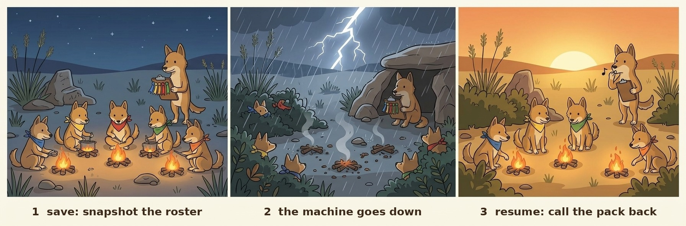

# 🐕 dingo-pack

<p align="center">
  
</p>

**A pack of coding agents on one computer: heavy work takes a slot, gets in by memory, is watched while it runs; dingo knows who is running, and after a crash who was lost.**

```sh
dingo-pack run --heavy --mem 4G -- pytest   # waits for a slot and free memory, runs under a cap
dingo-pack watch --daemon                   # watches every process: alert, pause, resume, kill at the edge
dingo-pack who                              # who runs what, room left, paused jobs, stalled sessions
dingo-pack list                             # after a crash: which sessions were lost
dingo-pack resume --midway --via print      # the command that continues each of them
```

🌐 **English** · [中文](https://github.com/liyifreddy/dingo-pack/blob/main/README.zh-CN.md)

The pack eats in order: dingoes share a kill without a scramble. dingo-pack is the pack
leader for a dozen coding agents on one machine. Its five core jobs:

1. **Slots for heavy work** — tests, builds, training, exports wait their turn (`run --heavy`).
2. **Admission by memory** — a job gets in when its declared peak fits what is free (minus what
   running jobs were promised and a reserve); CPU slots = cores; nothing is a fixed count.
3. **Watching while it runs** — `watch` sees every process of the user, also ones not started
   through dingo: it alerts, pauses (SIGSTOP) the job that would take the machine down, resumes
   it when there is room, kills only at the edge; it also reports a session whose status line
   says 跑着 (running) and has not moved for 2 h.
4. **Who is running** — `who` / the roster: sessions, their jobs, memory, status lines.
5. **After a crash, who was lost** — the roster is saved as you work (`save` / `mark`); `list`
   shows who was lost and `resume --via print` prints the command that continues each.
   Two safety nets: dingo keeps the roster of every session on the machine, shepherd-dispatch
   keeps the ones it started.

Moving out (still working here, each says where it goes): `board`, `name`, `card`, `lint`,
`queue` → shepherd-dispatch; `claim`, `boxes` → boobook-watch. No longer maintained (still
working): `close-all`, `stow`, and opening terminal tabs (`resume` / `restore` / `unstow` with
`--via wt|tmux`); `--via print` stays.

## 🚀 Quick start

```sh
pipx install git+https://github.com/liyifreddy/dingo-pack

dingo-pack                                    # one screen: memory, slots, sessions
dingo-pack run --heavy --mem 4G -- pytest     # heavy work waits for a slot and free memory
dingo-pack doctor                             # what's wrong with this machine right now?
dingo-pack list                               # after a crash: which sessions were lost
dingo-pack resume --midway                    # reopen the ones that were mid-task
```

In Claude Code, install the plugin and the roster saves itself:

```
/plugin marketplace add liyifreddy/dingo-pack
/plugin install dingo-pack@dingo-pack
```

One file, Python ≥ 3.8, standard library only. Linux, macOS and WSL.

## Release and installation demo

Current release: **0.4.2**. Install it from PyPI with pip or pipx:

```sh
python3 -m pip install dingo-pack        # or: pipx install dingo-pack
dingo-pack --version
```

To install from this source tree instead, use a separate environment:

```sh
python3 -m venv .venv-demo && .venv-demo/bin/python -m pip install .
.venv-demo/bin/dingo-pack --version
.venv-demo/bin/dingo-pack run --heavy --threads 1 --mem 64M -- python3 -c 'print("hello")'
```

Expected from either: `dingo-pack 0.4.2`; the source demo also prints `hello`
(admission may wait). State and locks must live on a local disk; leave `DINGO_HOME`
at its default, outside a WSL mounted drive. `boxes`, `tokens`, adapter validation
and task/wait columns are included; `dispatch` and the full three-table crosscheck
are not here (dispatch is shepherd-dispatch's job). See [CHANGELOG](CHANGELOG.md) and
[release procedure](RELEASING.md).

## Platforms and agents

| Platform | Support boundary | Tested for this candidate (2026-11-04) |
|---|---|---|
| Linux | POSIX CLI and `/proc` monitoring | WSL Linux kernel tested; separate native Linux host not tested |
| WSL2 | Run Python and the CLI inside WSL; state on the Linux disk | Tested: full suite, bounded CSV and install smoke |
| macOS | POSIX CLI, `ps`/`vm_stat` fallbacks; Linux-only probes may be unknown | Not tested; portable CI job added, not yet run |
| Native Windows | Unsupported: requires `fcntl`, POSIX signals and resource limits; use WSL2 | Tested with native Windows Python 3.14: actionable unsupported-platform message, exit 2 |

All three agents can use the same `run` queue on a supported host. No tool-specific
hook is required to wrap a shell command. Configuration examples below are manual
instructions, not enforcement hooks.

- **Claude Code:** plugin installation above supplies hooks; see [REFERENCE](REFERENCE.md)
  for manual hook configuration. The bundled `skills/dingo-pack/SKILL.md` supplies guidance.
- **Codex:** add the following rule to the project's `AGENTS.md`. Optionally copy
  `skills/dingo-pack/SKILL.md` into `.agents/skills/dingo-pack/SKILL.md` in that project.
- **OpenCode Go:** when using OpenCode with Go, put the same rule in the project's
  `AGENTS.md`. Alternatively reference a rule file in `opencode.json`:
  `{"$schema":"https://opencode.ai/config.json","instructions":["docs/heavy-work.md"]}`.
  No provider credentials are needed by dingo-pack.

```markdown
Before heavy shell work, run `dingo-pack who`, then wrap the command:
`dingo-pack run --heavy --mem <estimated peak> -- <command>`.
Use the same local DINGO_HOME for all agents sharing the machine.
Keep the queue and memory limits in force; report failures with the diagnostic line.
```

Claude Code has a built-in session/token adapter. Codex and OpenCode can share the
queue, but automatic session discovery, token counts, resume and close are not
provided for them. External read-only adapters can extend `top`/`tokens`/task columns;
[ADAPTERS](ADAPTERS.md) defines that interface. Roster and ghosts are still Claude-specific.
Agent UI sessions were not launched for this candidate's tests.

Sources: [Codex instructions](https://learn.chatgpt.com/docs/agent-configuration/agents-md),
[skills](https://learn.chatgpt.com/docs/build-skills),
[OpenCode rules](https://docs.opencode.ai/docs/rules/).

## Reading memory failures

On a failed job, the CLI preserves its exit status and prints configured per-process
and tree limits, sampled RSS, and the exit signal. `SIGSEGV`/139 and `SIGKILL`/137 with
a configured cap mean **possible memory limit hit**, not proof of OOM. A tree-limit
stop is confirmed by the supervisor. An ordinary nonzero exit keeps its cause unknown;
read the child's `MemoryError`, parser error or application error too.

Without configuration, defaults are `--mem 1G`, per-process `--limit 1.5G`, and matching tree limit.
`default_mem` / `DINGO_DEFAULT_MEM` overrides the estimate. RLIMIT_DATA
and RLIMIT_AS are not RSS: failed allocations and brief peaks can be missed by RSS
sampling. For large CSVs, prefer chunked reading; if more memory is needed, check
available memory and raise the estimate/caps together. Input file size alone does not
predict peak memory. `python3 selftest_release.py --large-csv` exercises a 670 MiB
synthetic CSV under bounded memory without loading gigabytes into RAM.

## 😩 The problem

- 💥 **Heavy jobs pile up.** Test runs, model loads, builds and reviews from several
  sessions start at once. In our 16 GB WSL VM, 13 sessions already used 4.4 GB; then the
  kernel killed a 7.5–11 GB Python job, and work in flight died with it.
- 🪟 **WSL drops its Windows drives.** When memory runs out, `/mnt/c`, `/mnt/g`, … start
  returning I/O errors until remounted — for every session at once.
- 👻 **Closed sessions leave things running.** Their python, node and MCP servers keep
  eating memory until the next big job tips the machine over.
- 🧠 **After a crash, who was running?** Our laptop went down with 8 sessions open. We
  pieced the list together from memory.

## ✨ Five things

- ✅ 🎟️ **Slots and memory.** `run --heavy` waits for a free slot (6 by default) *and*
  enough free memory, then runs the job under a memory limit for the whole process tree.
  On a simulated 350 MB machine, four 150 MB jobs started together hit the OOM killer;
  through dingo-pack, all four finish.
- ✅ 🚚 **A lane for slow disks.** `run --io` gives big copies, archives and scans on a
  network or 9p drive their own queue (1 at a time), apart from CPU work.
- ✅ 📋 **Roster: who is running, who was lost.** Sessions are noted as they work (`save`,
  `mark`); after a crash `list` shows who was lost and `resume --via print` prints the command
  that continues each. (Closing in bulk with `close-all` / `stow` and opening tabs are no
  longer maintained.)
- ✅ 👻 **Ghosts and sub-agent hints.** `ghosts` finds processes whose session is gone.
  The hint hook tells an agent, before it starts sub-agents or heavy commands, how many
  slots are free, how much memory is left, and how many jobs it should run in parallel.
- ✅ 🩺 **One-stop checkup.** `doctor` reads memory, recent OOM kills, whether each
  network drive still answers, your WSL settings, stuck slots, lost sessions, ghosts and
  git lock files (through [wombat-gate](https://github.com/liyifreddy/wombat-gate)). It
  only reports; it never fixes anything for you.

```
 heavy 0  [###### pytest  (est 2G) ######]
 heavy 1  [######### lease: code review #########]
 io    0  [## tar of the dataset ##]
 queue    C ──> D ──> E      next in line waits for a free slot AND enough memory
```

## 🎟️ Heavy work and slow disks

```sh
dingo-pack run --heavy --mem 6G -- python train.py       # wait for a slot + 6 GB, then run
dingo-pack run --heavy --mem 2G --timeout 30m -- pytest   # give up after 30 min (exit 75)
dingo-pack run --io -- tar -cf /mnt/g/backup.tar data/    # big copy on a slow disk: its own lane
dingo-pack who                                            # who holds the slots, who is waiting
dingo-pack top                                            # memory by session
```

- `--threads N` (default 8) sets `OMP_NUM_THREADS`, `MKL_NUM_THREADS`, `OPENBLAS_NUM_THREADS`
  and friends for the job and takes N of the machine's CPU slots (one per core). `doctor`
  and the hint warn when the load is above 1.5 per core.
- `--mem` is your best guess at the peak. The limit defaults to 1.5 × that; go over it
  and only your job stops (a single process gets a MemoryError; a whole tree over the
  limit is stopped with exit 137), not the machine.
- Work that isn't a shell command — an agent's own review, a batch of sub-agents — takes
  a lease: `dingo-pack lease --mem 3G --for 45m`, then `dingo-pack release`. The lease
  also ends when its agent exits.
- **No fixed number of slots.** By default memory and CPU decide: a job goes in when its
  `--mem` fits into available − promised to running jobs − reserve, else it queues; each job
  takes `--threads` CPU slots (one per core). `who` says how many more fit right now and why.
  Pin a number with `"slots": N` / `DINGO_SLOTS`; the reserve is `"reserve"` / `DINGO_RESERVE`
  (default max(1 GB, 10 % of RAM)).
- **Slow disks:** if the data can be copied to the local disk (`~/`, `/tmp`), copy it and work
  there; otherwise use `run --io` for bulk reads and writes on `/mnt/...`.

### Enforce it (Claude Code)

With `DINGO_ENFORCE=1` (or `"hook": {"enforce": true}`) the hint hook refuses instead of
hinting: a heavy-looking Bash command (pytest, `python run_all.py`, train / eval / export /
regress scripts, make, MinerU, ...; `bash -c`, `timeout`, `nohup`, `uv run`, `conda run` are
looked through, also `bash -lc` and `env … bash -c`) that is not under `dingo-pack run` is
denied, and the reason carries the command rewritten. Bulk copies, archives, `find` without
`-maxdepth`, and `grep -r` / `rg` over a big tree on a network / 9p mount are denied too;
`rg` / `grep -r` on a file or a small directory pass, a single-file `cp` only gets the hint, and
a `cd ~/x && …` first is taken into account. How much memory an inline `python -c` takes is not
judged: that is up to `--mem`, the rules and `watch`. Sub-agents and review skills
only get the hint. Any error in the hook lets the call through. Extend the rules under
`"hook"`: `heavy_words`, `heavy_scripts` (regex), `light_scripts` (regex), `enforce_io`.

### Keep watching while it runs: `watch`

```sh
dingo-pack watch --daemon          # background, single instance; dingo-pack watch stop
dingo-pack watch status            # memory per session, what is paused, recent alerts
dingo-pack watch resume 12345      # continue a paused job (or: all)
dingo-pack session --name X --max 8G -- claude ...   # an agent session with a name and a cap
```

- Every 2 s it looks at all of this user's processes, **also those not started through
  dingo-pack**, and groups them by session (`DINGO_SESSION` / `CLAUDE_PID` in the environment,
  else the nearest agent ancestor: claude, codex, opencode, hermes).
- Available memory below *warn* (default max(4 GB, 15 %)) or a process growing by 2 GB within
  60 s → an alert (`watch/events.jsonl`, the dingo log, `who`). Below *stop* (max(2.5 GB, 8 %))
  → it pauses (SIGSTOP) the fastest-growing job, else the biggest; nothing is lost, and it
  resumes it (SIGCONT) once there is room (at most twice per job, counted across pauses and
  watch restarts; after that it waits for `watch resume`). Every process is re-checked (start
  time, owner) right before each signal, so a reused pid is never hit. Below *kill* (max(1.2 GB, 4 %)) → it kills the
  biggest job and logs who, why, and the command to run it again. A session over its
  `session --max` gets its biggest job paused (not resumed by itself).
- Agent processes, shells, tmux and systemd are never touched; processes outside any session
  only raise alerts unless `"watch": {"unowned": "stop"}`. Thresholds: `"watch": {"warn",
  "stop", "kill", "interval", "grow_warn", ...}` or `DINGO_WATCH_WARN` etc. Cost here: ~0.5 % of
  one core and 30 MB for 160 processes.
- `session --max` uses a kernel cap (`systemd-run --user --scope -p MemoryMax=…`) where cgroup
  v2 has the memory controller delegated to the user; on WSL2's default cgroup v1 that has no
  effect, so `watch` enforces the cap.
- Every 5 min it also reads each live session's status line (as `board` does): one that says
  跑着 and has not changed for 2 h (`"watch": {"stall_h": 2}`) becomes an event and a `stalled:`
  line in `who` / `board` with the session, how long and the log. 已交 / 已关 / 等 Yi are left alone.
- `dingo-pack who --gate --need 4G` exits 1 when there is no room for a new session or a job is
  still paused (for launch scripts). `watch resume` also works while no watch runs, and the
  gate then lets the next one in.

## 📋 The roster

<p align="center">
  
</p>

1. **Save** — sessions are snapshotted as they work.
2. **The machine goes down** — the roster is already on disk.
3. **Resume** — `list` shows who was lost; `resume` calls them back.

<p align="center"><sub>Illustrations generated with Google Gemini and edited by the author.</sub></p>

```sh
dingo-pack mark running "step 3"           # say what you're doing: running | waiting | blocked | done
dingo-pack mark waiting --until 18:30 "nightly job"
dingo-pack list                            # after a crash: who was lost
dingo-pack resume NAME... --via print      # the command that continues each, to paste
dingo-pack close-all                       # (no longer maintained) close the idle waiting / done ones
dingo-pack restore                         # (opening tabs no longer maintained) bring back what close-all closed
```

`close-all` never touches a session that is busy, running, blocked, or the one you
type it in, and it checks each session again right before closing it. It is for humans:
inside an agent it refuses.

## 👻 Ghosts

```sh
dingo-pack ghosts                 # process trees whose Claude Code session is gone
dingo-pack ghosts --reap          # stop them, after asking (humans only)
```

A process belongs to the session whose `CLAUDE_PID` it carries. Jobs left on purpose
(nohup, setsid, tmux, or a session that said it is waiting) are listed but kept.

## 📊 Board

> Moving to shepherd-dispatch (it still works here; so do `name`, `card`, `lint`, `queue`).
> `claim` / `boxes` move to boobook-watch.

```sh
dingo-pack board                  # one line per session: state, box, expected finish, flags
dingo-pack board --html board.html --watch 30   # a page that refreshes itself
```

It reads each session's last status line. "ask now" means the expected finish it wrote
has passed; "may have stopped" means the status line has not changed for 3 hours
(`--stale-h`). It only understands an expected time after a word like 预计 / 约 … 完 / ETA;
anything else is left blank rather than guessed.

## 🧰 Team routines (optional)

> Moving to shepherd-dispatch together with the board.

`name` (next session name for a letter), `card new` (next free card number + skeleton),
`lint` (naming, one session per letter, stale or overdue status lines), `queue` (prompts
waiting for a condition) and `claim` (the per-box occupancy file). All are deterministic
and off unless you call them — see the [reference](REFERENCE.md).

## ⚙️ More

The plugin brings the CLI, the roster hooks, the hint hook and a skill that teaches the
agent when to use a slot. Hook setup without the plugin, project settings, every option
and WSL memory tips are in the [reference](REFERENCE.md).

## ⚠️ Limits

- The agent process itself can't be limited, only counted with a lease; `watch` never pauses
  or kills an agent process.
- Slots and memory admission only cover jobs started through dingo-pack; everything else is
  seen (and paused) only by `watch`, and only while it runs.
- The enforcing hook is tested with Claude Code only; for Codex / OpenCode it is AGENTS.md
  rules plus `watch`.
- `watch` samples every 2 s: an allocation faster than that can still get through, and on
  WSL2's cgroup v1 there is no kernel cap.
- Slots are handed out roughly first come, first served (the kernel decides who wakes first).
- macOS: the per-process limit isn't enforced (the tree limit is), and free memory is an
  estimate. `ghosts`, `top` and the WSL checks need Linux.
- The roster reads Claude Code's session files, which aren't a documented interface. If
  they change, it falls back to transcripts and says so.

## ✅ Self-test

```sh
python3 selftest_dingo_pack.py --base /some/local/dir    # 1–3 min, depending on load
python3 selftest_dingo_pack.py --mutants                 # each planted bug must turn a check red
```

Memory tests run on a simulated machine, never on your real memory.

## 📄 License

MIT. Sister tool: [wombat-gate](https://github.com/liyifreddy/wombat-gate), a git commit
queue for agents sharing one repo.
