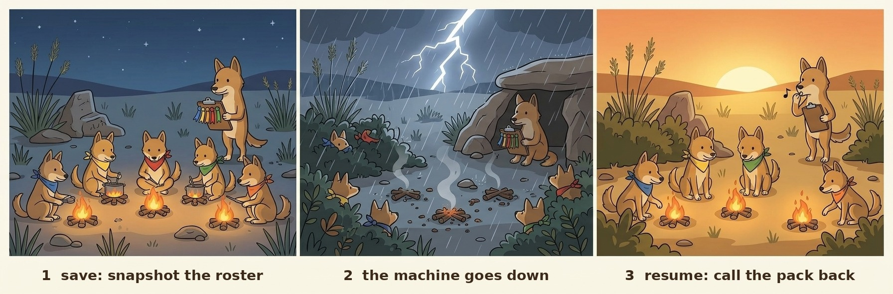

# 🐕 dingo-pack

<p align="center">
  
</p>

**像浏览器的标签页收纳，只不过收的是 Claude Code session。**

```sh
dingo-pack save          # 记住现在开着的 session（hook 也会自动记）
dingo-pack close-all     # 记住，并关掉空闲、在等或已完成的那些
dingo-pack restore       # 把最后一批放回来，每个开一个终端标签
```

🌐 [English](https://github.com/liyifreddy/dingo-pack/blob/main/README.md) · **中文**

野犬群按次序吃：一群澳洲野犬分食的时候不抢不挤。dingo-pack 是一台机器上十几个编程 agent 的「狗王」，还会给重活发名额，机器吃不消的时候帮你查哪里出了问题。

`restore` 在 WSL 里会给每个 session 开一个 Windows Terminal 新标签；在 tmux 里开 tmux 窗口；别的情况下只打印命令，你自己粘贴。`close-all` 只关空闲、而且自己说了在等或已完成的 session；这条命令只给人用，在 agent 里会被拒绝。

## 🚀 快速上手

```sh
pipx install git+https://github.com/liyifreddy/dingo-pack

dingo-pack                                    # 一屏总览：内存、名额、session
dingo-pack run --heavy --mem 4G -- pytest     # 重活先等名额和空闲内存，再跑
dingo-pack doctor                             # 这台机器现在哪里不对劲？
dingo-pack list                               # 死机之后：哪些 session 丢了
dingo-pack resume --midway                    # 把做到一半的重新打开
```

在 Claude Code 里装上插件，名册会自己保存：

```
/plugin marketplace add liyifreddy/dingo-pack
/plugin install dingo-pack@dingo-pack
```

一个文件，Python ≥ 3.8，只用标准库。Linux、macOS、WSL 都能用。

## 候选版本与安装演示

候选源码版本为 **0.4.1**（0.4.0 功能加内存提示与打包修复）。GitHub 公开 release
为 **0.1.1**。0.4.1 尚未部署或发布。
相较公开版本，增加 `boxes`、`tokens`、适配器校验及任务与等待列；`watch`、`dispatch`
和完整三表 crosscheck 仍是设计。见 [CHANGELOG](CHANGELOG.md) 与 [发布步骤](RELEASING.md)。

在审过的 checkout 中用独立环境试装：

```sh
python3 -m venv .venv-demo
.venv-demo/bin/python -m pip install .
.venv-demo/bin/dingo-pack --version
.venv-demo/bin/dingo-pack run --heavy --threads 1 --mem 64M -- python3 -c 'print("hello")'
```

预期输出 `dingo-pack 0.4.1`、`hello`；资源准入可能需要排队。状态与锁放本地盘，
`DINGO_HOME` 保持默认，不放 WSL 挂载盘。上面的 GitHub 快速安装命令装公开代码，
本地候选应从 checkout 试装。

## 平台与 agent

| 平台 | 支持范围 | 本候选实测（2026-11-04） |
|---|---|---|
| Linux | POSIX CLI 与 `/proc` 监测 | 已测 WSL Linux 内核；独立原生 Linux 主机没测 |
| WSL2 | Python 与 CLI 都在 WSL 内运行；状态放 Linux 盘 | 已测完整自测、限内存 CSV、安装冒烟 |
| macOS | POSIX CLI；`ps`/`vm_stat` 退路；Linux 专属探针可能显示未知 | 没测；已加便携 CI，尚未运行 |
| Windows 原生 | 当前依赖 `fcntl`、POSIX 信号与资源上限；请用 WSL2 | 已用 Windows 原生 Python 3.14 实测：清晰提示改用 WSL2，退出 2 |

三种 agent 在支持的平台上可共用 `run` 队列，包一条 shell 命令不要求专有 hook。
下面的配置是给 agent 的规矩，不是强制拦截器。

- **Claude Code**：上面的 plugin 安装提供 hooks；手动 hook 配置见 [REFERENCE](REFERENCE.md)。
  仓内 `skills/dingo-pack/SKILL.md` 提供用法。
- **Codex**：把下方规则放入项目 `AGENTS.md`。也可把仓内 `skills/dingo-pack/SKILL.md`
  复制到目标项目 `.agents/skills/dingo-pack/SKILL.md`。
- **OpenCode Go**：使用 OpenCode 搭配 Go 时，也把规则放项目 `AGENTS.md`；或在
  `opencode.json` 引入规则文件：
  `{"$schema":"https://opencode.ai/config.json","instructions":["docs/heavy-work.md"]}`。
  dingo-pack 不需要任何模型服务凭据。

```markdown
重活前先跑 `dingo-pack who`，再用以下命令包住实际任务：
`dingo-pack run --heavy --mem <预计峰值> -- <命令>`。
同机共享资源的 agent 使用同一个本地 DINGO_HOME。
保留队列和内存上限；失败时把诊断行一起回报。
```

内置会话与 token 适配器目前只有 Claude Code。Codex、OpenCode 能共用排队命令，
其自动会话发现、token 读取、恢复和关闭尚未提供。可通过外部只读适配器扩展
`top`、`tokens` 和任务列，接口见 [ADAPTERS](ADAPTERS.md)。名册和 ghosts 仍直接接 Claude。
本候选测试没有启动三种 agent 的交互会话。

依据：[Codex 指令](https://learn.chatgpt.com/docs/agent-configuration/agents-md)、
[skills](https://learn.chatgpt.com/docs/build-skills)、
[OpenCode 规则](https://docs.opencode.ai/docs/rules/)。

## 看懂内存失败

任务失败时，CLI 保留退出码，并输出单进程配置上限、整树上限、采样 RSS 与退出信号。
配置了上限时出现 `SIGSEGV`/139 或 `SIGKILL`/137，会提示「可能撞限」，不把信号当作
OOM 的证明；由监督器触发的整树超限则明确标为已确认。普通非零退出保留原因未知，
还需看子命令的 `MemoryError`、解析器错误或业务错误。

无配置时默认 `--mem 1G`，单进程 `--limit 1.5G`，整树上限相同；
`default_mem` / `DINGO_DEFAULT_MEM` 可覆盖预估。RLIMIT_DATA/AS 与 RSS 不是同一个量，
失败的分配或很短的峰值可能采不到。大 CSV 优先分块读取；确需增加内存时先看余量，
同步调整预估与上限。输入文件大小不能直接换算内存峰值。
`python3 selftest_release.py --large-csv` 用 670 MiB 合成 CSV 验证限内存失败与流式成功。

## 😩 遇到的问题

- 💥 **重活挤在一起。** 几个 session 的测试、模型加载、构建、代码审查同时开跑。我们 16 GB 的 WSL 里，13 个 session 本身就占了 4.4 GB；接着内核杀掉了一个 7.5–11 GB 的 Python，手上的活跟着没了。
- 🪟 **WSL 的 Windows 盘会掉。** 内存一用光，`/mnt/c`、`/mnt/g` 就一直报 I/O 错误，要重新挂载才好，所有 session 一起受影响。
- 👻 **关掉的 session 留下进程。** 它开的 python、node、MCP 服务还在吃内存，下一件大活一来，机器就撑不住了。
- 🧠 **死机之后记不住开过哪些。** 笔记本死机时开着 8 个 session，事后只能靠回忆一个个找。

## ✨ 五件事

- ✅ 🎟️ **名额和内存。** `run --heavy` 先等一个空名额（默认 6 个），再等内存够用，然后给整件活（连同它开的子进程）套上内存上限。在一台假装只有 350 MB 的机器上，四件 150 MB 的活一起跑会被系统杀掉；走 dingo-pack 四件都能跑完。
- ✅ 🚚 **慢盘单独一条道。** `run --io` 让网络盘 / 9p 盘上的大拷贝、打包、扫描单独排队（一次一个），不跟算力活抢。
- ✅ 📋 **名册：收起、放出、召回。** 关机前 `close-all` 记下所有 session，并关掉那些空闲、而且在等或已完成的；之后 `restore` 一键放回来；死机之后 `restore` 也能用，它会放回死机时丢掉的那些。
- ✅ 👻 **幽灵进程和子 agent 提示。** `ghosts` 找出主人已经不在的进程。提示 hook 会在 agent 开子 agent 或跑重命令之前告诉它：还剩几个名额、还有多少内存、现在最多该并行几件。
- ✅ 🩺 **一次查完。** `doctor` 看内存、最近有没有被 OOM 杀掉的进程、每个网络盘还应不应答、WSL 设置、卡住的名额、丢了的 session、幽灵进程，以及 git 的锁文件（通过 [wombat-gate](https://github.com/liyifreddy/wombat-gate)）。只报告，不替你改。

```
 heavy 0  [###### pytest（约 2G）######]
 heavy 1  [######### 租约：代码审查 #########]
 io    0  [## 打包数据集 ##]
 queue    C ──> D ──> E      排在最前的要等到空名额，而且内存够用
```

## 🎟️ 重活和慢盘

```sh
dingo-pack run --heavy --mem 6G -- python train.py       # 等名额和 6 GB 内存，再跑
dingo-pack run --heavy --mem 2G --timeout 30m -- pytest   # 等 30 分钟还没轮到就放弃（退出码 75）
dingo-pack run --io -- tar -cf /mnt/g/backup.tar data/    # 慢盘上的大拷贝：走单独的道
dingo-pack who                                            # 谁占着名额、谁在等
dingo-pack top                                            # 每个 session 用了多少内存
```

- `--threads N`（默认 8）给这件活设好 `OMP_NUM_THREADS`、`MKL_NUM_THREADS`、`OPENBLAS_NUM_THREADS` 等线程数，并占用 N 个 CPU 名额（全机名额数 = 核数）。负载超过每核 1.5 时，`doctor` 和提示 hook 会报警。
- `--mem` 填你估计的最高用量。上限默认是它的 1.5 倍；超了只停你这件（单个进程会遇到 MemoryError 自己退出，整棵进程树超了会被停掉、退出码 137），不会拖垮整台机器。
- 不是一条 shell 命令的重活（agent 自己的审查、一批子 agent），用租约：`dingo-pack lease --mem 3G --for 45m`，做完 `dingo-pack release`。agent 退出时租约也会自动放掉。

## 📋 名册

<p align="center">
  
</p>

1. **拍名册**：session 干活的时候，名册跟着更新。
2. **机器倒了**：名册已经存在盘上。
3. **召回**：`list` 看丢了谁，`resume` 把它们叫回来。

<p align="center"><sub>Illustrations generated with Google Gemini and edited by the author.</sub></p>

```sh
dingo-pack mark running "第 3 步"          # 报一下自己在干嘛：running | waiting | blocked | done
dingo-pack mark waiting --until 18:30 "等夜里的任务"
dingo-pack close-all                    # 关机前：记下所有人，关掉空闲的、在等或已完成的
dingo-pack restore                         # 把 close-all 关掉的放回来
dingo-pack resume 名字… --via tmux         # 按名字打开；可以用 Windows Terminal、tmux，或只打印命令
```

`close-all` 不碰正在忙、正在跑、卡住等人的 session，也不碰你敲命令的这一个；关每一个之前都会再确认一次它的状态。这条命令只给人用，在 agent 里会被拒绝。

## 👻 幽灵进程

```sh
dingo-pack ghosts                 # 主人 session 已经不在的进程
dingo-pack ghosts --reap          # 问过你之后把它们停掉（只给人用）
```

进程属于哪个 session，看它带的 `CLAUDE_PID`。故意留着的（nohup、setsid、tmux，或者那个 session 自己说了在等）会列出来，但不会被收。

## 📊 看板

```sh
dingo-pack board                  # 每个 session 一行：状态、box、预计完成、提醒
dingo-pack board --html board.html --watch 30   # 生成一个会自己刷新的网页
```

它读每个 session 最后一行状态行。「ask now」是它自己写的预计完成时刻已经过了；「may have stopped」是状态行 3 小时（`--stale-h`）没变过。预计时刻只认跟在「预计 / 约 … 完 / ETA」这类字眼后面的；认不出就空着，不猜。

## 🧰 团队惯例（可选）

`name`（某个字母今天的下一个 session 名）、`card new`（下一个空卡号 + 卡头骨架）、`lint`（命名、同字母只活一个、状态行过期或预计已过）、`queue`（等条件的待发 prompt）、`claim`（每台 box 的占用登记文件）。全是确定性的，不调用就不起作用，详见 [REFERENCE.md](REFERENCE.md)。

## ⚙️ 更多

插件里有命令行、名册 hook、提醒 hook，还有一段教 agent 什么时候该排队的说明。不装插件时怎么配 hook、项目设置、全部选项、WSL 内存设置，都在 [REFERENCE.md](REFERENCE.md)（英文）。

## ⚠️ 局限

- agent 进程本身限制不了，只能用租约把它算进去。
- 只管通过 dingo-pack 启动的活。
- 名额大致先到先得（谁先醒由内核决定）。
- macOS：单进程上限不生效（整棵上限有效），空闲内存是估算的；`ghosts`、`top` 和 WSL 检查只在 Linux 上可用。
- 名册读的是 Claude Code 自己的 session 文件，这不是公开接口。格式变了的话，会改为只看会话记录，并且会说明。

## ✅ 自测

```sh
python3 selftest_dingo_pack.py --base /某个本地目录    # 1–3 分钟，看机器忙不忙
python3 selftest_dingo_pack.py --mutants              # 故意放回的每个 bug 都必须被抓到
```

内存测试在一台模拟的机器上跑，不会真的占满你的内存。

## 📄 许可

MIT。姊妹工具：[wombat-gate](https://github.com/liyifreddy/wombat-gate)，给共用一个仓库的 agent 排队提交。
